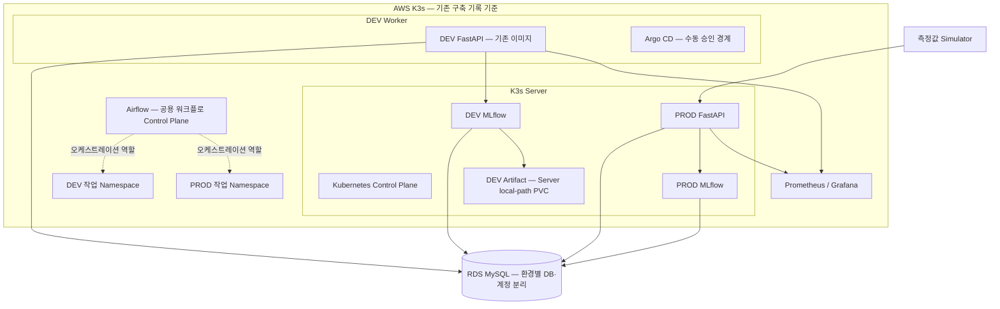
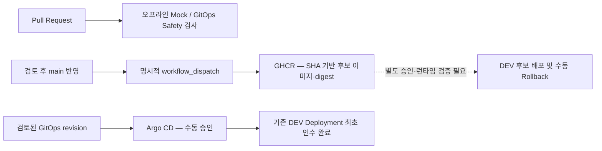

# Kubernetes 기반 데이터센터 AI 모니터링 시스템

CPU·메모리·온도·전력 측정값을 시뮬레이션하고, FastAPI와 머신러닝으로 이상을 탐지하는 프로젝트입니다. AWS K3s에서 DEV/PROD를 분리하고 MLflow, Airflow, 모니터링, CI 및 GitOps를 단계적으로 연결해 운영·복구 절차를 학습합니다. Dify와 Amazon Bedrock은 운영자가 요청한 장애 분석을 보조합니다.

> **구축 기록 기준: 2026-10-31 / 소스 통합 검토: 2026-11-01.** 아래 운영 검증 결과는 명시된 시점과 범위의 기록이며, 현재 서비스 상태를 상시 보증하지 않습니다. MLflow 추가 소스는 별도 검토용 후보이며 실제 배포·DB Migration·Worker 이전을 수행하지 않았습니다. 실제 접속 주소·계정·인증정보는 공개하지 않습니다.

## 현재 구축 현황

| 영역 | 확인된 상태 | 남은 작업 또는 검증 한계 |
|---|---|---|
| AWS K3s | Server와 DEV Worker의 2개 노드 구성, Worker Join·Pod 네트워크 검증 완료 | Kubernetes control plane은 단일 Server. 다중 control-plane HA 구성 아님 |
| DEV FastAPI | Worker 이전 완료. 기존 이미지의 상태 확인·RDS 인증·모델 추론 및 저장 검증 완료 | GHCR 후보 이미지의 실행 검증과 구분 |
| PROD FastAPI | 기존 Server 배치 유지, HPA 사용 | 과거 기동 실패의 인프라 근본 원인 전체가 해결됐다는 의미는 아님 |
| MLflow Tracking / Registry | 기존 기록상 DEV/PROD 인스턴스 분리, 두 인스턴스 모두 Server 유지. 환경별 Auth·Registry·학습 소스를 선별 통합 | 추가 소스의 live E2E·PROD Auth 승격·DEV MLflow Worker 이전은 미실행 |
| Airflow | 공용 워크플로 Control Plane과 DEV/PROD 작업 Namespace 구분. 기존 API server·scheduler·DAG processor 구성 확인 | DAG·배포 정의는 현재 main에 미포함. 최신 DAG E2E 성공을 이 문서에서 판정하지 않음 |
| GitHub Actions / GHCR | 오프라인 CI 및 수동 후보 이미지 게시·digest 검증 완료 | 이미지 게시가 Kubernetes 배포를 의미하지 않음 |
| Argo CD | 설치 및 기존 DEV Deployment의 최초 수동 Sync 완료 | GHCR 이미지 전환·해당 이미지의 수동 Rollback 실증은 보류 |
| Prometheus / Grafana | 애플리케이션 메트릭·scrape 설정·대시보드 구현과 초기 운영 검증 기록 보유 | 이번 문서 작업에서 모니터링 서비스를 다시 시험하지 않음 |
| Dify / Amazon Bedrock | 수동 장애 분석 경로 구현, 2026-09-16 실제 연동 1회 성공 기록 | 현재 IAM·외부 연동·전송 보안 상태의 재검증과 구분 |
| GKE | 후속 이전 계획 | 클러스터 구축·워크로드 이전 미수행 |

## AWS 아키텍처와 환경 분리

실선은 기존 배치·데이터 경로를, 점선은 공용 워크플로의 역할을 나타냅니다. Airflow 작업의 최신 E2E 완료를 의미하지 않습니다.



- DEV FastAPI는 Worker의 DEV Label과 정확한 Taint toleration으로 배치를 제한합니다. PROD 애플리케이션과 기존 ServiceLB 배치는 Server에 유지하는 원칙입니다.
- Taint는 스케줄링 조건입니다. Namespace·NetworkPolicy·DB 계정·RBAC·배포 승인까지 함께 검토하며, Taint 하나로 DEV/PROD 전체 격리가 완성됐다고 보지 않습니다.
- Airflow의 **워크플로 Control Plane**은 Kubernetes의 **클러스터 control plane**과 다른 역할입니다. 공용 오케스트레이션 구성과 개별 DEV/PROD 작업의 권한·실행 검증을 구분합니다.
- 노드가 2개여도 Server 장애 시 control plane 가용성이나 Server 로컬 데이터가 자동으로 보호되지는 않습니다. 재시작 복구 실습과 인프라 HA는 별개입니다.

## FastAPI, MLflow와 데이터 흐름

Simulator가 전달한 측정값을 FastAPI가 `NORMAL` 또는 `ANOMALY`로 분류합니다. 추론 결과는 RDS에 저장하며, 메트릭은 Prometheus 수집 대상으로 노출합니다.

MLflow는 실험의 파라미터·지표·Artifact를 관리하는 Tracking과 모델 버전을 관리하는 Registry를 담당합니다. 기존 DEV Worker 검증에서는 Registry 모델 version 1의 로딩과 실제 추론을 확인했습니다. 환경별 DB·인증 참조를 분리하며 비밀번호와 연결 URL은 문서나 Git에 포함하지 않습니다.

DEV MLflow Artifact는 Server에 고정된 `local-path` PVC에 있습니다. `RWO`, 10Gi 용량, `Delete` reclaim policy이므로 Deployment의 Node만 바꾸는 방식으로 이전할 수 없습니다. 마지막 조사에서 Artifact 16개, 약 3.27MiB를 확인했으며, 이는 당시 스냅샷입니다.

이전에는 쓰기 일관성 확보, 원본 백업, Worker 저장소·이미지·DB 인증 준비, 파일별 checksum·권한 비교, 새 쓰기 이후의 롤백 데이터 보존이 필요합니다. 원본 PVC/PV는 검증 전에 삭제하지 않습니다. Airflow 작업과 MLflow 메타데이터·Artifact의 연계도 별도 E2E 검증 대상입니다.

### MLflow 소스 통합 범위

이 통합 후보는 최신 main의 FastAPI 계약과 CI·GHCR·GitOps 설정을 유지하며 MLflow 학습·Projects, 공통 Auth guard, 환경별 구성과 관련 테스트를 추가합니다. 기존 기본 로컬 모델 경로와 명시적으로 선택하는 Registry 경로를 구분합니다. 학습·Projects 실행은 명시적인 Tracking URI가 필요하며 승인된 별도 쓰기 작업입니다. Registry 로딩은 고정 Version 1만 허용하며 실패 시 로컬 모델이나 다른 환경으로 자동 전환하지 않습니다. Auth는 허용 목록과 자원별 권한을 함께 검사하며, 대응하는 권한 검증기가 없는 요청도 거부합니다.

`k8s/overlays/dev`와 `k8s/overlays/prod`는 **미적용 검토 후보**입니다. 운영 중인 Secret·PVC·DB와 동일한 상태라고 가정하거나 전체 overlay를 적용하지 않습니다. Migration·bootstrap Job은 중지된 선언이며 실행·DB 변경·PROD Auth 활성화에는 별도 검증과 승인이 필요합니다. 이미지 digest는 이전 후보의 식별자이며 이번 통합 commit의 빌드·배포 증거가 아닙니다. 자세한 범위와 미검증 사항은 [MLflow 통합 검토](docs/mlflow/integration-review.md)를 참고하세요.

### 합성 데이터 학습 기록

[데이터 생성](generate_data.py)과 [학습·평가 코드](train_model.py)는 6개 서버의 합성 측정 데이터 6,000건을 사용합니다. Random Forest를 stratified 80/20으로 학습·평가한 [저장된 지표](reports/metrics.json)는 다음과 같습니다.

| 지표 | 저장된 결과 |
|---|---:|
| 평가 데이터 | 1,200건 |
| Accuracy | 99.83% |
| Precision | 99.22% |
| Recall | 100% |
| F1 | 99.61% |
| TN / FP / FN / TP | 944 / 2 / 0 / 254 |

합성 데이터에서 얻은 수치이며 실제 데이터센터 장애 탐지 성능을 의미하지 않습니다. 이 평가 파일과 현재 운영 Registry Artifact가 동일하다는 연결 근거도 별도로 확인해야 합니다. 이번 문서 작성에서 재학습이나 성능 테스트를 실행하지 않았습니다.

## Prometheus / Grafana

FastAPI의 `/metrics`는 다음 측정·추론 메트릭을 제공합니다.

```text
datacenter_cpu_percent
datacenter_memory_percent
datacenter_temperature_celsius
datacenter_power_watts
datacenter_predictions_total
datacenter_anomalies_total
```

[대시보드 JSON](grafana/dashboards/datacenter-monitoring-dashboard.json)은 CPU·메모리·온도·전력, Prediction Status, Anomaly Rate를 보여줍니다. [Prometheus 설정](k8s/prometheus-values.yaml)과 [Grafana 설정](k8s/grafana-values.yaml)은 기존 실습 소스입니다. 현재 운영 설정을 그대로 재현하는 배포 명령으로 취급하지 않습니다.

기존 화면 이미지는 파일로 보존하되, 화면 안의 접속 정보에 대한 공개 검토가 완료되지 않아 이 README에서 다시 삽입하지 않습니다.

## Dify / Amazon Bedrock 장애 분석

머신러닝은 이상 여부를 분류하고, Dify는 운영자가 요청한 장애 컨텍스트를 설명하는 별도 경로입니다. Dify의 내부 severity 분기는 다음 기준을 사용한 실습 기록을 갖습니다.

| 조건 | 분기 |
|---|---|
| anomaly rate ≥ 0.30 | CRITICAL |
| anomaly rate ≥ 0.15 | HIGH |
| anomaly count > 0 | MEDIUM |
| 그 외 | LOW |


2026-09-16 기록에서는 EC2 IAM Role/IMDS와 APAC inference profile을 사용해 실제 분석 1회의 성공 및 비어 있지 않은 결과 문자열을 확인했습니다. 현재 IAM 권한이나 장기 운영 안정성을 다시 검증했다는 뜻은 아닙니다.

### FastAPI에서 분석 요청

| API 동작 | 구현된 계약 |
|---|---|
| `GET /analysis/context` | 분석에 사용할 측정값 컨텍스트 조회 |
| `POST /analysis/run` | 수동 분석 요청. 기본 조회 범위는 최근 30분·최근 이상 5건 |
| 데이터 없음 | HTTP 200, skipped/no_data 반환, Dify 호출 생략 |
| 외부 분석 timeout | HTTP 504. 실행이 계속될 수 있어 자동 재호출하지 않음 |

`/predict`가 Dify 분석을 자동 실행하지 않습니다. LLM은 원인 확정이나 운영 설정 변경을 수행하지 않으며, 입력에서 확인할 수 없는 원인은 가설로 구분합니다. 역할과 한계는 [LLM 비교 기록](docs/llm-comparison.md)을 참고하세요. 저장소에 남은 HTTP 인증 전송 구성은 보안 검토 후 별도 개선할 항목입니다.

## GitHub Actions / GHCR / Argo CD



- [FastAPI CI](.github/workflows/fastapi-ci.yml)와 [GitOps Safety CI](.github/workflows/gitops-safety.yml)가 PR을 검증합니다. 외부 Actions는 commit SHA로 고정하고 PR Token은 읽기 권한으로 제한합니다.
- [GHCR workflow](.github/workflows/ghcr-dev-candidate.yml)는 main에서 명시적으로 수동 실행합니다. Publish Job에만 `packages:write`를 두며 SHA 기반 후보 태그와 digest를 기록합니다. 게시 자체로 AWS 배포가 발생하지 않습니다.
- Argo CD `v3.5.6` 설치와 **기존 이미지 상태의 DEV Deployment 최초 수동 Sync**는 완료했습니다. 당시 Deployment spec·Pod template·Pod UID를 유지한 관리 metadata 인수였습니다.
- Auto Sync·Prune·SelfHeal은 OFF입니다. PROD 자동 동기화는 활성화하지 않았으며, AppProject 제한과 controller의 실제 Kubernetes 권한은 별도로 검증합니다.
- Git의 Application에는 승인 전 실행을 막는 revision placeholder가 남아 있습니다. 실제 등록에 사용하는 검토된 commit과 승인 경계를 [GitOps 설계](gitops/DESIGN.md) 및 [실행 절차](gitops/CD01_RUNBOOK.md)에서 구분합니다.
- 공개 main에는 PR #5의 후보 provenance·계약 보완이 반영되어 있습니다. **GHCR 후보의 실제 Worker Pull·배포·추론·수동 Rollback은 아직 미실행**입니다. 후보는 기존 운영 이미지와 소스가 달라 단순 Registry 이동으로 볼 수 없습니다.
- 성공 `/predict`는 DB INSERT를 수반합니다. 후속 후보 검증에서는 인증·읽기 확인과 실제 쓰기를 포함하는 E2E의 승인 범위를 먼저 분리해야 합니다.

## 테스트와 검증 범위

| 시점 | 확인한 내용 | 결과의 범위 |
|---|---|---|
| 초기 학습 실습 | 합성 데이터 평가 지표 | 위 저장된 metrics. 운영 모델 성능 보증 아님 |
| 2026-09-16 | FastAPI → Dify → Bedrock 분석 1회, 분석 컨텍스트 조회 | 당시 연동 성공. 현재 외부 서비스 재검증 아님 |
| 2026-10-24 | DEV FastAPI Worker 이전, 상태 확인·RDS 인증·기존 모델 추론/저장 | 약 5분 관찰을 포함한 이전 PASS. GHCR 후보 검사 아님 |
| 2026-10-25 | GitHub Actions 게시 workflow | Python 3.12 환경의 오프라인 Mock 76 PASS, Fail/Error/Skip 0. GHCR 게시·digest 확인 |
| 2026-10-26~27 | Argo CD 설치 및 런타임 | 필수 Pod Ready, 권한 경계 검사 32/32 PASS 기록 |
| 2026-10-31 | PR #5 CI | FastAPI 76 PASS, GitOps Safety 33 PASS. 현재 main에 반영된 변경의 기존 CI 증거 |
| 2026-10-31 | DEV 최초 수동 Sync | 기존 이미지·Pod 유지, Synced/Healthy 및 임시 권한 회수 기록 |
| 미실행 | GHCR 후보 런타임·수동 Rollback, DEV MLflow Worker 이전, GKE 이전 | 완료로 판정하지 않음 |

Mock·정적 검사, 제한된 운영 관찰, 실제 E2E는 서로 다른 근거입니다. 이번 README 작성에서는 기존 PASS를 재실행하지 않았습니다. 과거 PROD 기동 장애의 일부 실패 경로를 확인했지만 인프라 수준의 모든 재발 원인이 해결됐다고 주장하지 않습니다.

## 초기 Kubernetes 실습 기록

다음은 **초기 single-node K3s 환경**에서 수행한 실습입니다. 현재 2개 노드 구성의 최신 실행 결과와 구분해 보존합니다.

| 실습 | 당시 관측한 동작 | 배운 점 |
|---|---|---|
| Self-healing | 관리되는 Pod 삭제 후 새 Pod 생성, 정상 replica 복구 | Deployment의 선언 상태 복원 |
| NetworkPolicy | Simulator → API 허용, Simulator → Prometheus 차단, 정책 제거 시 통신 성공 | 허용/차단을 각각 검증해야 함 |
| HPA | CPU 부하에 따라 2 → 3, 종료 후 3 → 2 | Desired replica와 Ready/Available을 함께 관찰 |
| K3s 서비스 재시작 | API·Simulator·모니터링 복구, API 통신 및 RDS 저장 재개 | 서비스 복구와 인프라 HA를 구분 |

당시 HPA 실습 값은 min 2 / max 3, CPU 목표 20%, Pod CPU request 100m였고 관측 CPU 사용률은 약 334%까지 증가했습니다. 이는 과거 실험 조건이며 현재 설정 변경 지침이 아닙니다. 재시작·부하·삭제 명령은 공개 README의 실행 절차로 제공하지 않습니다.

## 공개 저장소와 보안 경계

2026-10-31 공개 Git 감사 결과는 **WARN**입니다. 접근 가능한 브랜치·히스토리 검사에서 실제 인증정보 노출은 확인하지 못했지만, 전문 secret scanner 미사용·PNG 화면 미검증·접근 불가능한 과거 기록 등의 한계가 있습니다.

후속 검토 항목은 Dify HTTP 인증 전송, legacy 외부 Service/API 인증 경계, 빌드 의존성·base image 고정, ServiceAccount token·seccomp 보강입니다. 저장소 선언만으로 실제 운영 노출이나 침해를 확정하지 않습니다. 보안 위험을 숨기기 위해 과거 실습 파일을 삭제하지 않았으며, 수정은 별도 검토와 승인 대상으로 둡니다.

- 비밀번호·Token·Secret data·개인키·kubeconfig·실제 운영 접속 정보는 README에 넣지 않습니다.
- `k8s/`에는 초기 실습·호환 구성과 미적용 MLflow 통합 후보가 함께 있습니다. 현재 AWS Live와 일치한다고 가정하지 않으며, 디렉터리 전체를 운영 클러스터에 재적용하지 않습니다.
- 공개 main, 미병합 작업 브랜치, 현재 운영 이미지가 동일한 버전이라고 가정하지 않습니다. MLflow 작업 브랜치 전체를 병합하지 않고 필요한 소스를 최신 main 위에서 선별 검토합니다. 기존 Draft PR #7과 로컬 추가 작업은 보존 대상입니다.

## 저장소 안내와 후속 GKE 계획

| 경로 | 내용 |
|---|---|
| `backend/`, `simulator/` | 추론·DB·모델 로딩·분석 API와 측정값 Simulator |
| `generate_data.py`, `train_model.py`, `reports/metrics.json` | 합성 데이터 학습 및 평가 기록 |
| `tests/` | 오프라인 Mock·구조·GitOps 안전성 검사 |
| `.github/workflows/` | CI와 수동 GHCR 게시 |
| `gitops/` | DEV 후보/기존 이미지 overlay, Application/Project, 승인·복구 절차 |
| `k8s/`, `grafana/` | 초기 배포·모니터링 자료와 미적용 MLflow DEV/PROD 후보 |
| `docs/` | 과거 설계·실험·연동 문서. 작성 시점을 함께 확인 |

환경별 MLflow 소스 정의는 이번 통합 후보에 포함되며 운영 배포 상태와는 구분합니다. Airflow DAG와 일부 로컬 추가 작업·로드맵은 이 통합 범위에 포함하지 않습니다. 공개되지 않은 로컬 경로를 재현 가능한 실행 자료처럼 링크하지 않습니다.

후속 작업은 다음 순서로 검토합니다.

1. AWS DEV의 GHCR 후보 런타임 검증·수동 Rollback과 PROD 승인 통제를 마무리합니다.
2. DEV MLflow의 백업·데이터 일관성·저장소·계정 준비 후 Worker 이전을 별도 승인합니다.
3. 실습 기록·운영 근거·보안 보강 항목을 정리하고, 브랜치와 GitOps Source의 역할을 명확히 합니다.
4. GKE에서 클러스터·권한·이미지·데이터 이전 및 복구 계획을 검증합니다. GKE Standard, Kubeflow Pipelines/Istio와 선택적 Autopilot 비교는 **계획**이며 구축 완료 항목이 아닙니다.

실제 운영 변경·PR 병합·브랜치 삭제는 문서 준비와 분리해 승인합니다.
